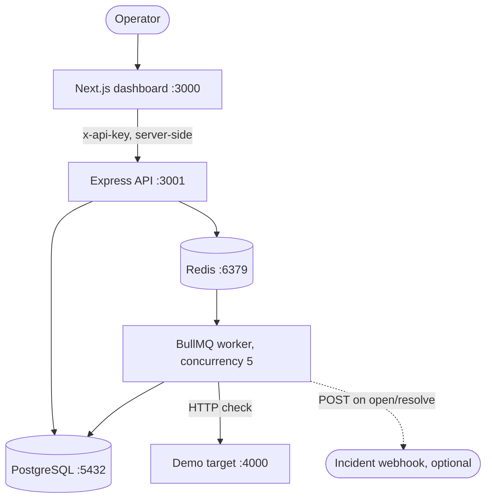
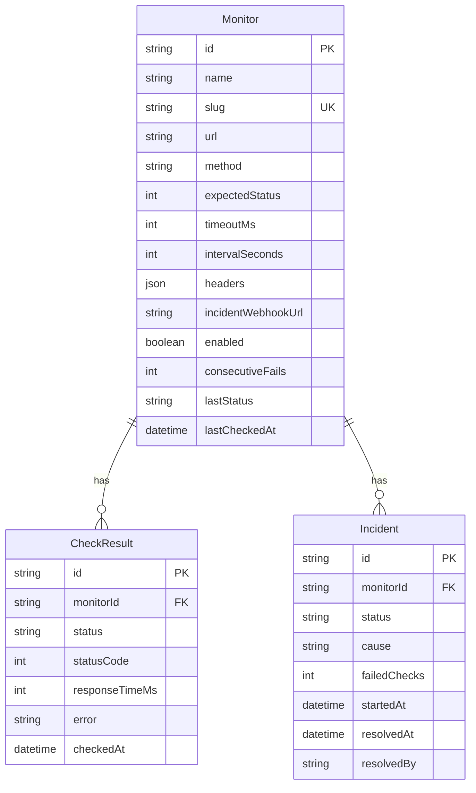
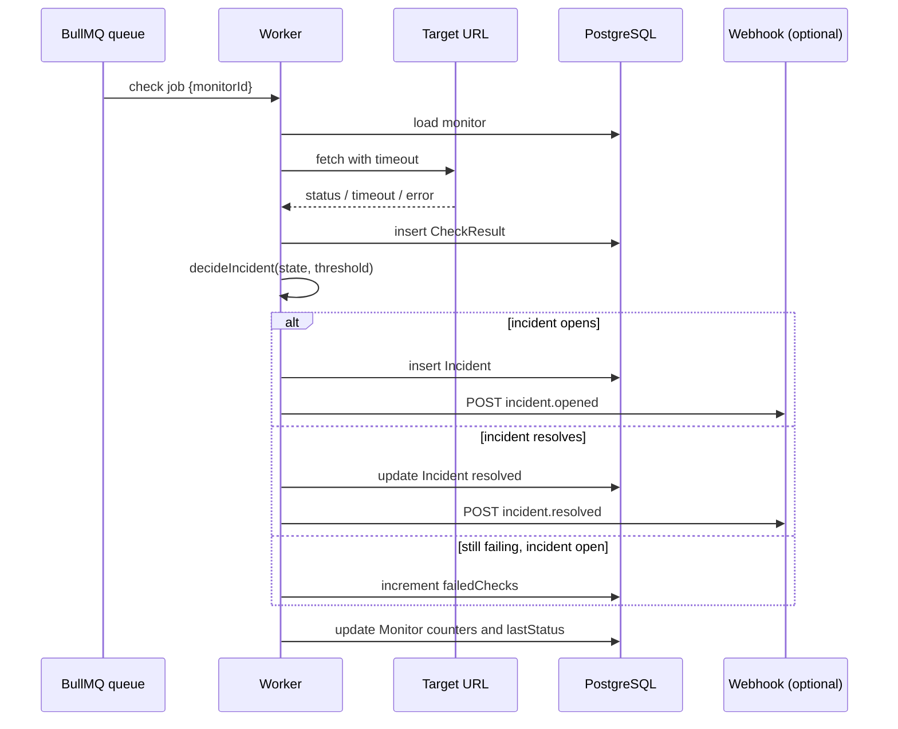
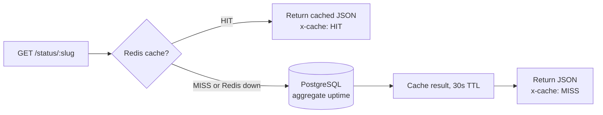

# Architecture

## Overview

API Health Monitoring and Incident Tracker is a small self-hosted uptime
monitor. Four services work together: an Express API, a BullMQ worker, a
Next.js dashboard, and a demo target. PostgreSQL stores all state. Redis
holds the check queue and a short-lived status page cache.

## Services

### API (`apps/api`, port 3001)

Express 4 with TypeScript in strict mode. It owns three concerns:

- Management routes under `/api/*`, protected by the `requireApiKey`
  middleware, which compares the `x-api-key` header with `ADMIN_API_KEY`.
  If the key is not configured, every management route returns 500.
- Public status routes under `/status/*` with no auth.
- Scheduling: on startup `syncSchedules()` reconciles BullMQ repeatable
  jobs with the monitors table (schedule every enabled monitor, drop jobs
  for monitors that are gone or disabled, and keep the daily prune job).
  Creating, updating, or deleting a monitor reschedules that monitor
  through `ensureSchedule()` / `removeSchedule()`.

The API also owns the status cache (`src/cache.ts`): Redis with a 30
second TTL, `x-cache: HIT` / `MISS` headers, and invalidation of
`status:<slug>` when a monitor changes. If Redis is unset or unreachable,
the API logs one warning and serves everything from PostgreSQL.

JSON bodies are limited to 256kb. Unknown routes return
`{"error": "not found"}` with status 404.

### Worker (`apps/worker`)

A BullMQ `Worker` on the `health-checks` queue with concurrency 5. It
handles two job names:

- `check` and `check-now`: run one health check for a monitor id.
- `prune`: delete `CheckResult` rows older than 90 days, once a day.

The worker exits at startup if `REDIS_URL` is not set. It handles
`SIGTERM` and `SIGINT` by closing the worker and disconnecting Prisma.

One check (`src/check.ts`) is a plain `fetch` with an `AbortController`
timeout. Response time is time-to-first-byte, measured from request start
to response headers. The response body is cancelled without being read. A
check is "up" only when the HTTP status exactly matches the monitor's
expected status. Anything else, including a timeout or a network error,
is "down" with an error message capped at 500 characters.

### Dashboard (`apps/web`, port 3000)

Next.js 14 App Router with standalone output. All data fetching happens
server-side through `lib/api.ts`, so the management key (`API_KEY`) never
reaches the browser. Server actions in `app/actions.ts` handle monitor
creation, check-now, pause/resume, delete, and incident resolution.

Routes:

- `/` - monitor overview with status, uptime bars, and latency.
- `/monitors/[id]` - detail with response-time chart, last 50 checks,
  last 20 incidents.
- `/incidents` - incident inbox with open, resolved, and all filters.
- `/status` and `/status/[slug]` - public status pages, served from the
  keyless API endpoints.

### Demo target (`apps/demo-target`, port 4000)

A tiny Express service with five endpoints used to see the monitoring
loop work: `/ok` (200 at once), `/slow` (200 after about 2.5s), `/flaky`
(alternates 200 and 500), `/dead` (500 always), `/hang` (never responds).

## Data model

Prisma schema in `apps/api/prisma/schema.prisma`, copied identically to
`apps/worker/prisma/schema.prisma`. The initial migration is
`apps/api/prisma/migrations/0001_init/migration.sql`.

- `Monitor.slug` is unique and is the public status page address
  (`/status/:slug`). Slugs are made from the monitor name plus a random
  3-byte hex suffix, so duplicate names stay unique.
- `CheckResult` rows are pruned after 90 days by the daily worker job.
- `Incident` rows are kept indefinitely. `resolvedBy` is `worker` or
  `manual`.

## Check flow

## Incident rules

The rules live in one pure function, `decideIncident()` in
`apps/worker/src/incidents.ts`, so they can be unit-tested without a
database. Given the check outcome, the consecutive-failure count before
the check, any open incident, and the threshold:

- Success with an open incident: resolve it, reset the counter to 0.
- Success with no open incident: reset the counter, do nothing.
- Failure: increment the counter. If an incident is already open, bump
  its `failedChecks`. If the counter reaches the threshold and no incident
  is open, open one. Otherwise do nothing.
- The threshold is clamped to at least 1, so a threshold of 0 or below
  behaves like 1.

`INCIDENT_THRESHOLD` defaults to 2 and is read by both the API and the
worker from the environment.

## Status page flow

`GET /status` returns `overall` as `operational` when no enabled monitor
is currently down, otherwise `degraded`. A monitor change invalidates
its cached status page.

## Failure modes

- Redis down: the API still serves reads and writes, but no checks are
  scheduled, "Check now" returns 503, and status pages run uncached.
  The worker cannot run without Redis and exits at startup if
  `REDIS_URL` is not set.
- PostgreSQL down: management and status endpoints fail, since every
  read and write needs the database. The API process itself still starts
  and listens.
- Redis down and `GET /health`: the request blocks instead of answering,
  because `/health` waits on BullMQ queue readiness. This was observed
  on 2026-11-06 and is a known limitation. Do not use `/health` as a
  fast liveness probe where Redis may be down.
- Monitor target down: the check records a `down` result with the error
  message, and the incident rules apply. A hanging target is cut off by
  the monitor timeout.
- Webhook receiver down: the webhook POST has a 5 second timeout and
  never throws. A failing webhook is logged and never fails the check.

## Deployment shape

`docker-compose.yml` runs six services on one host: `postgres` (16),
`redis` (7), `demo-target`, `api`, `worker`, and `web`. The API image
runs `prisma migrate deploy` on container start, then starts the server.
The web image uses the Next.js standalone output. See the README
Deployment section for the single-host rollout notes.
